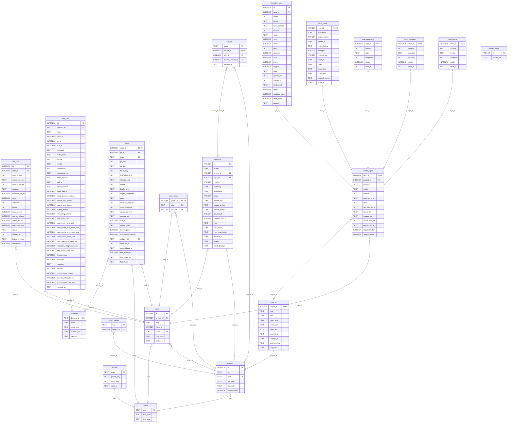

<!-- Generated by github.com/trick77/ship/kit/schemadoc, do not edit. Regenerate in the Go module directory: SCHEMADOC_UPDATE=1 go test ./... -run TestSchemaDoc -->

# Database schema

20 tables; the diagram is at the end. Go types are the `model.go` structs whose rows they hold.

## baseline_runs

Go types:

- `store.BaselineRun` (internal/store): BaselineRun is one run as stored. Plan is the catalogue, the worker's to read; the store keeps it verbatim.
- `store.FinishedRun` (internal/store): FinishedRun is a run that ended, with what the poller's retry reads of its repository: whether it is the newest run of its kind, and how many runs failed since the newest done one (LastRun's count). A restyle is a kind of its own: the newest restyle, its failures its page's at its epoch as RestyleState counts them (one that failed on the project page, the project's over the project); a reading run's never count a restyle, as LastRun's.

| Column | Type | Null | Default | PK |
| --- | --- | --- | --- | --- |
| `id` | INTEGER | no |  | 1 |
| `repo_id` | INTEGER | no |  |  |
| `mode` | TEXT | no |  |  |
| `trigger` | TEXT | no |  |  |
| `base_commit` | TEXT | no | `''` |  |
| `commit` | TEXT | no |  |  |
| `state` | TEXT | no |  |  |
| `step` | INTEGER | no | `0` |  |
| `steps` | INTEGER | no | `0` |  |
| `plan` | TEXT | yes |  |  |
| `attempts` | INTEGER | no | `0` |  |
| `calls` | INTEGER | no | `0` |  |
| `bytes` | INTEGER | no | `0` |  |
| `skipped` | INTEGER | no | `0` |  |
| `error` | TEXT | no | `''` |  |
| `queued_at` | TEXT | no |  |  |
| `started_at` | TEXT | yes |  |  |
| `finished_at` | TEXT | yes |  |  |
| `epoch` | INTEGER | no | `0` |  |
| `readable_bytes` | INTEGER | no | `0` |  |
| `read_bytes` | INTEGER | no | `0` |  |
| `reason` | TEXT | yes |  |  |

Foreign keys:

- `repo_id` → `source_repos` (`repo_id`), on delete CASCADE

Indexes:

- `baseline_runs_open_idx` (`repo_id`) unique where `state NOT IN ('done', 'failed')`
- `baseline_runs_repo_idx` (`repo_id`, `id DESC`)

Checks:

- `CHECK (mode IN ('full', 'reconcile', 'restyle'))`
- `CHECK (trigger IN ('manual', 'first_ready', 'monthly', 'retry', 'departure', 'epoch'))`
- `CHECK (state IN ('queued', 'cataloguing', 'describing', 'project', 'done', 'failed'))`
- `CHECK (json_valid(plan))`
- `CHECK (queued_at GLOB '????-??-??T??:??:??.?????????Z')`
- `CHECK (started_at GLOB '????-??-??T??:??:??.?????????Z')`
- `CHECK (finished_at GLOB '????-??-??T??:??:??.?????????Z')`
- `CHECK (reason IS NULL OR (json_valid(reason) AND json_type(reason) = 'object'))`
- `CHECK (mode = 'full' OR base_commit <> '')`
- `CHECK ((mode = 'restyle') = (trigger = 'epoch'))`

## claims

| Column | Type | Null | Default | PK |
| --- | --- | --- | --- | --- |
| `team` | TEXT | no |  |  |
| `project_key` | TEXT | no |  |  |
| `repo_slug` | TEXT | yes |  |  |
| `seen_at` | TEXT | no |  |  |

Foreign keys:

- `team` → `teams` (`slug`)

Indexes:

- `claims_project_idx` (`team`, `project_key`) unique where `repo_slug IS NULL`
- `claims_repo_idx` (`team`, `project_key`, `repo_slug`) unique where `repo_slug IS NOT NULL`

Checks:

- `CHECK (seen_at GLOB '????-??-??T??:??:??.?????????Z')`

## deliveries

| Column | Type | Null | Default | PK |
| --- | --- | --- | --- | --- |
| `delivery_id` | TEXT | yes |  | 1 |
| `team` | TEXT | no |  |  |
| `event_type` | TEXT | no |  |  |
| `received_at` | TEXT | no |  |  |
| `payload` | TEXT | no |  |  |

Indexes:

- `deliveries_team_idx` (`team`, `received_at`)

Checks:

- `CHECK (received_at GLOB '????-??-??T??:??:??.?????????Z')`
- `CHECK (json_valid(payload))`

## llm_calls

Go types:

- `store.RunCall` (internal/store): RunCall is one model call of a run, for its steps on the queue page.

| Column | Type | Null | Default | PK |
| --- | --- | --- | --- | --- |
| `id` | INTEGER | no |  | 1 |
| `repo_id` | INTEGER | no |  |  |
| `source_kind` | TEXT | no | `'pr'` |  |
| `source_pr_key` | TEXT | yes |  |  |
| `source_commit` | TEXT | yes |  |  |
| `purpose` | TEXT | no | `'merge'` |  |
| `baseline_run_id` | INTEGER | yes |  |  |
| `step` | INTEGER | yes |  |  |
| `outcome` | TEXT | no |  |  |
| `model` | TEXT | yes |  |  |
| `input_tokens` | INTEGER | yes |  |  |
| `cached_tokens` | INTEGER | yes |  |  |
| `output_tokens` | INTEGER | yes |  |  |
| `cost_nano_usd` | INTEGER | yes |  |  |
| `call_id` | TEXT | yes |  |  |
| `created_at` | TEXT | no |  |  |
| `batch_pr_keys` | TEXT | yes |  |  |
| `streamed` | INTEGER | no | `0` |  |

Foreign keys:

- `repo_id` → `repos` (`id`)

Indexes:

- `llm_calls_created_idx` (`created_at`)
- `llm_calls_repo_idx` (`repo_id`)
- `llm_calls_run_idx` (`baseline_run_id`) where `baseline_run_id IS NOT NULL`

Checks:

- `CHECK (source_kind IN ('pr', 'baseline', 'page'))`
- `CHECK (purpose IN ('merge', 'catalogue', 'overview', 'subject', 'project', 'repo_map', 'project_map', 'restyle', 'brief'))`
- `CHECK (created_at GLOB '????-??-??T??:??:??.?????????Z')`
- `CHECK (batch_pr_keys IS NULL OR (json_valid(batch_pr_keys) AND json_type(batch_pr_keys) = 'array'))`
- `CHECK (streamed IN (0, 1))`
- `CONSTRAINT llm_calls_source_pr CHECK ((source_kind = 'pr') = (source_pr_key IS NOT NULL))`
- `CONSTRAINT llm_calls_source_commit CHECK ((source_kind = 'baseline') = (source_commit IS NOT NULL))`
- `CONSTRAINT llm_calls_source_page CHECK ((source_kind = 'page') = (purpose = 'brief'))`

## note_calls

Go types:

- `store.NoteCallRow` (internal/store): NoteCallRow is the recorded note call, the lanes a reader wants.

| Column | Type | Null | Default | PK |
| --- | --- | --- | --- | --- |
| `id` | INTEGER | no |  | 1 |
| `delivery_id` | TEXT | no |  |  |
| `team` | TEXT | no |  |  |
| `repo_id` | INTEGER | no |  |  |
| `pr_id` | INTEGER | no |  |  |
| `run_id` | INTEGER | yes |  |  |
| `outcome` | TEXT | yes |  |  |
| `note_status` | TEXT | yes |  |  |
| `profile` | TEXT | yes |  |  |
| `model` | TEXT | yes |  |  |
| `deployment` | TEXT | yes |  |  |
| `reasoning_sent` | TEXT | yes |  |  |
| `finish_reason` | TEXT | yes |  |  |
| `call_id` | TEXT | yes |  |  |
| `litellm_version` | TEXT | yes |  |  |
| `input_tokens` | INTEGER | yes |  |  |
| `input_uncached_tokens` | INTEGER | yes |  |  |
| `cache_read_tokens` | INTEGER | yes |  |  |
| `cache_write_tokens` | INTEGER | yes |  |  |
| `output_tokens` | INTEGER | yes |  |  |
| `reasoning_tokens` | INTEGER | yes |  |  |
| `cost_nano_usd` | INTEGER | yes |  |  |
| `cost_input_nano_usd` | INTEGER | yes |  |  |
| `cost_cache_read_nano_usd` | INTEGER | yes |  |  |
| `cost_cache_write_nano_usd` | INTEGER | yes |  |  |
| `cost_output_nano_usd` | INTEGER | yes |  |  |
| `cost_reasoning_nano_usd` | INTEGER | yes |  |  |
| `cost_tool_usage_nano_usd` | INTEGER | yes |  |  |
| `key_spend_nano_usd` | INTEGER | yes |  |  |
| `headers_ms` | INTEGER | yes |  |  |
| `total_ms` | INTEGER | yes |  |  |
| `warnings` | TEXT | no | `'[]'` |  |
| `rounds` | INTEGER | no | `0` |  |
| `rounds_input_tokens` | INTEGER | no | `0` |  |
| `rounds_output_tokens` | INTEGER | no | `0` |  |
| `rounds_cost_nano_usd` | INTEGER | yes |  |  |
| `created_at` | TEXT | no |  |  |

Foreign keys:

- `repo_id` → `repos` (`id`)
- `delivery_id` → `deliveries` (`delivery_id`)

Indexes:

- `note_calls_note_idx` (`repo_id`, `pr_id`)
- `note_calls_team_idx` (`team`, `created_at`)

Checks:

- `CHECK (json_valid(warnings))`
- `CHECK (created_at GLOB '????-??-??T??:??:??.?????????Z')`

## notes

Go types:

- `store.FailedNote` (internal/store): FailedNote is a note the merge call failed on, off the queue until the repository's next run (RequeueFailed) or, at the worker's bound of attempts, for good.
- `store.FoldedNote` (internal/store): FoldedNote is a note the worker took off the queue: folded, refused or ignored. Outcome and cost are the last merge call of this delivery (made between its arrival and its fold), one it shared with its repository's other notes too; "" and nil when it made none (a note for a repository that is no source). Batch is how many notes that call folded, 1 for one: its cost is the whole call's, not this note's share.
- `store.Note` (internal/store): Note is one merged PR's note as the sender described it, lifted into columns beside the raw object.
- `store.NoteDetail` (internal/store): NoteDetail is one note in full.
- `store.NoteRow` (internal/store): NoteRow is one note as listed.
- `store.PendingNote` (internal/store): PendingNote is a note the worker has not folded yet.
- `store.QueuedNote` (internal/store): QueuedNote is the next note the worker folds in. DeliveryID is the delivery that wrote this version of the note: a second note for the same PR replaces the row and queues it again, and the mark of a fold that read the first must not take the second off the queue.

| Column | Type | Null | Default | PK |
| --- | --- | --- | --- | --- |
| `repo_id` | INTEGER | no |  | 1 |
| `pr_id` | INTEGER | no |  | 2 |
| `team` | TEXT | no |  |  |
| `pr_key` | TEXT | no |  |  |
| `pr_title` | TEXT | no |  |  |
| `ticket_key` | TEXT | yes |  |  |
| `jira_issue_type` | TEXT | yes |  |  |
| `change_kind` | TEXT | yes |  |  |
| `bugfix` | TEXT | yes |  |  |
| `bugfix_area` | TEXT | yes |  |  |
| `bugfix_component` | TEXT | yes |  |  |
| `note` | TEXT | no |  |  |
| `reviewed_commit` | TEXT | yes |  |  |
| `source_commit` | TEXT | no |  |  |
| `merge_commit` | TEXT | yes |  |  |
| `merged_at` | TEXT | no |  |  |
| `run_id` | INTEGER | yes |  |  |
| `model_label` | TEXT | yes |  |  |
| `issues_posted` | INTEGER | no | `0` |  |
| `suggestions_posted` | INTEGER | no | `0` |  |
| `delivery_id` | TEXT | no |  |  |
| `received_at` | TEXT | no |  |  |
| `consolidated_at` | TEXT | yes |  |  |
| `fold_attempts` | INTEGER | no | `0` |  |
| `fold_failed_at` | TEXT | yes |  |  |
| `fold_failed` | TEXT | yes |  |  |

Foreign keys:

- `delivery_id` → `deliveries` (`delivery_id`)
- `team` → `teams` (`slug`)
- `repo_id` → `repos` (`id`)

Indexes:

- `notes_failed_idx` (`fold_failed_at`) where `fold_failed_at IS NOT NULL`
- `notes_folded_idx` (`consolidated_at`) where `consolidated_at IS NOT NULL`
- `notes_queue_idx` (`received_at`) where `consolidated_at IS NULL`
- `notes_repo_idx` (`repo_id`, `merged_at DESC`)

Checks:

- `CHECK (json_valid(bugfix))`
- `CHECK (json_valid(note))`
- `CHECK (merged_at GLOB '????-??-??T??:??:??.?????????Z')`
- `CHECK (received_at GLOB '????-??-??T??:??:??.?????????Z')`
- `CHECK (consolidated_at GLOB '????-??-??T??:??:??.?????????Z')`
- `CHECK (fold_failed_at IS NULL OR fold_failed_at GLOB '????-??-??T??:??:??.?????????Z')`
- `CHECK (fold_failed IS NULL OR fold_failed <> '')`

## pages

Go types:

- `store.Page` (internal/store): Page is a description as currently published.
- `store.PageText` (internal/store): PageText is a current page's words, the search's read: its names and summary, each statement's words alone (no sources, no diagram, which a search neither reads nor shows).

| Column | Type | Null | Default | PK |
| --- | --- | --- | --- | --- |
| `scope` | TEXT | no |  | 1 |
| `project_id` | INTEGER | no |  | 2 |
| `repo_id` | INTEGER | no | `0` | 3 |
| `current_revision_id` | INTEGER | no |  |  |
| `updated_at` | TEXT | no |  |  |

Foreign keys:

- `current_revision_id` → `revisions` (`id`)
- `project_id` → `projects` (`id`)

Checks:

- `CHECK (updated_at GLOB '????-??-??T??:??:??.?????????Z')`

## project_names

| Column | Type | Null | Default | PK |
| --- | --- | --- | --- | --- |
| `key` | TEXT | yes |  | 1 |
| `project_id` | INTEGER | no |  |  |

Foreign keys:

- `project_id` → `projects` (`id`)

Indexes:

- `project_names_project_idx` (`project_id`)

## projects

Go types:

- `store.ProjectRow` (internal/store): ProjectRow is one project in the list.

| Column | Type | Null | Default | PK |
| --- | --- | --- | --- | --- |
| `id` | INTEGER | no |  | 1 |
| `key` | TEXT | no |  |  |
| `team` | TEXT | yes |  |  |
| `first_seen` | TEXT | yes |  |  |
| `last_seen` | TEXT | yes |  |  |
| `restyle_epoch` | INTEGER | no | `0` |  |

Foreign keys:

- `team` → `teams` (`slug`)

Indexes:

- `sqlite_autoindex_projects_1` (`key`) unique

Checks:

- `CHECK (first_seen GLOB '????-??-??T??:??:??.?????????Z')`
- `CHECK (last_seen GLOB '????-??-??T??:??:??.?????????Z')`

## repo_briefs

Go types:

- `store.Brief` (internal/store): Brief is a repository's brief as stored. Markdown is "" before the first was written, and in the listing (Briefs), which carries HasMarkdown alone.
- `store.BriefJob` (internal/store): BriefJob is the worker's next brief: a request to write it (Write), or a written one to push (Markdown).

| Column | Type | Null | Default | PK |
| --- | --- | --- | --- | --- |
| `repo_id` | INTEGER | no |  | 1 |
| `markdown` | TEXT | yes |  |  |
| `page_revision` | INTEGER | yes |  |  |
| `written_at` | TEXT | yes |  |  |
| `requested_at` | TEXT | yes |  |  |
| `attempts` | INTEGER | no | `0` |  |
| `request_seq` | INTEGER | no | `0` |  |
| `failed_at` | TEXT | yes |  |  |
| `failed` | TEXT | yes |  |  |
| `push_state` | TEXT | yes |  |  |
| `push_error` | TEXT | yes |  |  |
| `pushed_commit` | TEXT | yes |  |  |
| `push_at` | TEXT | yes |  |  |

Foreign keys:

- `repo_id` → `source_repos` (`repo_id`), on delete CASCADE

Indexes:

- `repo_briefs_due_idx` (`push_at`) where `push_state = 'due'`
- `repo_briefs_requested_idx` (`requested_at`) where `requested_at IS NOT NULL`

Checks:

- `CHECK (markdown IS NULL OR markdown <> '')`
- `CHECK (written_at IS NULL OR written_at GLOB '????-??-??T??:??:??.?????????Z')`
- `CHECK (requested_at IS NULL OR requested_at GLOB '????-??-??T??:??:??.?????????Z')`
- `CHECK (failed_at IS NULL OR failed_at GLOB '????-??-??T??:??:??.?????????Z')`
- `CHECK (failed IS NULL OR failed <> '')`
- `CHECK (push_state IS NULL OR push_state IN ('due', 'pushed', 'unchanged', 'failed'))`
- `CHECK (push_error IS NULL OR push_error <> '')`
- `CHECK (push_at IS NULL OR push_at GLOB '????-??-??T??:??:??.?????????Z')`
- `CHECK ((markdown IS NULL) = (written_at IS NULL))`
- `CHECK ((markdown IS NULL) = (page_revision IS NULL))`
- `CHECK (push_state IS NULL OR markdown IS NOT NULL)`
- `CHECK ((failed_at IS NULL) = (failed IS NULL))`
- `CHECK ((push_state = 'failed') = (push_error IS NOT NULL))`

## repo_endpoints

| Column | Type | Null | Default | PK |
| --- | --- | --- | --- | --- |
| `repo_id` | INTEGER | no |  | 1 |
| `commit` | TEXT | no |  |  |
| `apis` | TEXT | no |  |  |
| `endpoints` | TEXT | no |  |  |
| `reader` | INTEGER | no |  |  |
| `read_at` | TEXT | no |  |  |

Foreign keys:

- `repo_id` → `source_repos` (`repo_id`), on delete CASCADE

Checks:

- `CHECK (json_valid(apis) AND json_type(apis) = 'array')`
- `CHECK (json_valid(endpoints) AND json_type(endpoints) = 'array')`
- `CHECK (read_at GLOB '????-??-??T??:??:??.?????????Z')`

## repo_manifests

| Column | Type | Null | Default | PK |
| --- | --- | --- | --- | --- |
| `repo_id` | INTEGER | no |  | 1 |
| `commit` | TEXT | no |  |  |
| `provides` | TEXT | no |  |  |
| `requires` | TEXT | no |  |  |
| `reader` | INTEGER | no |  |  |
| `read_at` | TEXT | no |  |  |

Foreign keys:

- `repo_id` → `source_repos` (`repo_id`), on delete CASCADE

Checks:

- `CHECK (json_valid(provides) AND json_type(provides) = 'array')`
- `CHECK (json_valid(requires) AND json_type(requires) = 'array')`
- `CHECK (read_at GLOB '????-??-??T??:??:??.?????????Z')`

## repo_names

| Column | Type | Null | Default | PK |
| --- | --- | --- | --- | --- |
| `project_id` | INTEGER | no |  | 1 |
| `slug` | TEXT | no |  | 2 |
| `repo_id` | INTEGER | no |  |  |

Foreign keys:

- `repo_id` → `repos` (`id`)
- `project_id` → `projects` (`id`)

Indexes:

- `repo_names_repo_idx` (`repo_id`)

## repo_topics

| Column | Type | Null | Default | PK |
| --- | --- | --- | --- | --- |
| `repo_id` | INTEGER | no |  | 1 |
| `commit` | TEXT | no |  |  |
| `topics` | TEXT | no |  |  |
| `schemas` | TEXT | no |  |  |
| `reader` | INTEGER | no |  |  |
| `read_at` | TEXT | no |  |  |

Foreign keys:

- `repo_id` → `source_repos` (`repo_id`), on delete CASCADE

Checks:

- `CHECK (json_valid(topics) AND json_type(topics) = 'array')`
- `CHECK (json_valid(schemas) AND json_type(schemas) = 'array')`
- `CHECK (read_at GLOB '????-??-??T??:??:??.?????????Z')`

## repos

Go types:

- `store.RepoRef` (internal/store): RepoRef names a source repository in the dependency graph.
- `store.RepoRow` (internal/store): RepoRow is one repository of a project.
- `store.RepoSummary` (internal/store): RepoSummary is a source repository and its current summary, whole, with Contracts, its statements other repositories rely on: its interfaces and entities, in the page's order.

| Column | Type | Null | Default | PK |
| --- | --- | --- | --- | --- |
| `id` | INTEGER | no |  | 1 |
| `project_id` | INTEGER | no |  |  |
| `slug` | TEXT | no |  |  |
| `forge_id` | INTEGER | yes |  |  |
| `team` | TEXT | yes |  |  |
| `first_seen` | TEXT | yes |  |  |
| `last_seen` | TEXT | yes |  |  |

Foreign keys:

- `team` → `teams` (`slug`)
- `project_id` → `projects` (`id`)

Indexes:

- `repos_project_idx` (`project_id`)
- `sqlite_autoindex_repos_1` (`project_id`, `slug`) unique
- `sqlite_autoindex_repos_2` (`project_id`, `forge_id`) unique

Checks:

- `CHECK (first_seen GLOB '????-??-??T??:??:??.?????????Z')`
- `CHECK (last_seen GLOB '????-??-??T??:??:??.?????????Z')`

## revisions

Go types:

- `store.RevisionRow` (internal/store): RevisionRow is one entry of a page's history.
- `store.TaughtRow` (internal/store): TaughtRow is one current statement a pull request's note is a source of: where it stands, and enough to name and link it.

| Column | Type | Null | Default | PK |
| --- | --- | --- | --- | --- |
| `id` | INTEGER | no |  | 1 |
| `scope` | TEXT | no |  |  |
| `project_id` | INTEGER | no |  |  |
| `repo_id` | INTEGER | yes |  |  |
| `revision` | INTEGER | no |  |  |
| `summary` | TEXT | no |  |  |
| `statements` | TEXT | no |  |  |
| `chars` | INTEGER | no |  |  |
| `source_kind` | TEXT | no | `'pr'` |  |
| `source_pr_key` | TEXT | yes |  |  |
| `source_commit` | TEXT | yes |  |  |
| `llm_call_id` | INTEGER | yes |  |  |
| `baseline_run_id` | INTEGER | yes |  |  |
| `map` | TEXT | yes |  |  |
| `repo_map` | TEXT | yes |  |  |
| `repo_map_basis` | TEXT | yes |  |  |
| `created_at` | TEXT | no |  |  |
| `shape` | TEXT | yes |  |  |
| `batch_pr_keys` | TEXT | yes |  |  |

Foreign keys:

- `repo_id` → `repos` (`id`)
- `project_id` → `projects` (`id`)

Indexes:

- `revisions_key_idx` (`scope`, `project_id`, `COALESCE(repo_id, 0)`, `revision`) unique

Checks:

- `CHECK (scope IN ('repository', 'project'))`
- `CHECK (json_valid(statements))`
- `CHECK (source_kind IN ('pr', 'baseline'))`
- `CHECK (json_valid(map))`
- `CHECK (json_valid(repo_map))`
- `CHECK (created_at GLOB '????-??-??T??:??:??.?????????Z')`
- `CHECK (shape IS NULL OR (scope = 'project' AND shape IN ('system', 'collection')))`
- `CHECK (batch_pr_keys IS NULL OR (json_valid(batch_pr_keys) AND json_type(batch_pr_keys) = 'array'))`
- `CHECK ((scope = 'project') = (repo_id IS NULL))`
- `CONSTRAINT revisions_source_pr CHECK ((source_kind = 'pr') = (source_pr_key IS NOT NULL))`
- `CONSTRAINT revisions_source_commit CHECK ((source_kind = 'baseline') = (source_commit IS NOT NULL))`
- `CONSTRAINT revisions_map_scope CHECK (map IS NULL OR scope = 'project')`
- `CONSTRAINT revisions_repo_map_scope CHECK (repo_map IS NULL OR scope = 'repository')`
- `CONSTRAINT revisions_repo_map_basis_scope CHECK (repo_map_basis IS NULL OR scope = 'repository')`

## source_repos

Go types:

- `store.SourceRepo` (internal/store): SourceRepo is one clone. ProjectID and RepoID are its ids, ProjectKey and Slug its current names.
- `store.heldRow` (internal/store): heldRow is a source row holding a clone URL.

| Column | Type | Null | Default | PK |
| --- | --- | --- | --- | --- |
| `repo_id` | INTEGER | no |  | 1 |
| `project_id` | INTEGER | no |  |  |
| `clone_url` | TEXT | no |  |  |
| `origin` | TEXT | no |  |  |
| `branch` | TEXT | yes |  |  |
| `head_commit` | TEXT | no | `''` |  |
| `state` | TEXT | no |  |  |
| `last_synced_at` | TEXT | yes |  |  |
| `last_error` | TEXT | no | `''` |  |
| `created_at` | TEXT | no |  |  |
| `deactivated_at` | TEXT | yes |  |  |
| `reactivated_at` | TEXT | yes |  |  |
| `departure_due` | INTEGER | no | `0` |  |
| `restyle_epoch` | INTEGER | no | `0` |  |

Foreign keys:

- `project_id` → `sources` (`project_id`), on delete CASCADE
- `repo_id` → `repos` (`id`)

Indexes:

- `source_repos_project_idx` (`project_id`)

Checks:

- `CHECK (origin IN ('listed', 'manual'))`
- `CHECK (state IN ('pending', 'syncing', 'ready', 'failed', 'missing'))`
- `CHECK (last_synced_at GLOB '????-??-??T??:??:??.?????????Z')`
- `CHECK (created_at GLOB '????-??-??T??:??:??.?????????Z')`
- `CHECK (deactivated_at GLOB '????-??-??T??:??:??.?????????Z')`
- `CHECK (reactivated_at GLOB '????-??-??T??:??:??.?????????Z')`
- `CHECK (departure_due IN (0, 1))`

## sources

Go types:

- `store.ProjectSource` (internal/store): ProjectSource is one configured project source.
- `store.SourceRow` (internal/store): SourceRow is a source with its repositories counted by state.

| Column | Type | Null | Default | PK |
| --- | --- | --- | --- | --- |
| `project_id` | INTEGER | no |  | 1 |
| `kind` | TEXT | no |  |  |
| `host` | TEXT | yes |  |  |
| `token_auth` | TEXT | no |  |  |
| `token_user` | TEXT | no | `''` |  |
| `token_enc` | BLOB | yes |  |  |
| `created_at` | TEXT | no |  |  |
| `updated_at` | TEXT | no |  |  |
| `last_listed_at` | TEXT | yes |  |  |
| `last_error` | TEXT | no | `''` |  |

Foreign keys:

- `project_id` → `projects` (`id`)

Checks:

- `CHECK (kind IN ('bitbucket', 'static'))`
- `CHECK (token_auth IN ('bearer', 'basic'))`
- `CHECK (created_at GLOB '????-??-??T??:??:??.?????????Z')`
- `CHECK (updated_at GLOB '????-??-??T??:??:??.?????????Z')`
- `CHECK (last_listed_at GLOB '????-??-??T??:??:??.?????????Z')`

## teams

| Column | Type | Null | Default | PK |
| --- | --- | --- | --- | --- |
| `slug` | TEXT | yes |  | 1 |
| `first_seen` | TEXT | no |  |  |
| `last_seen` | TEXT | no |  |  |

Checks:

- `CHECK (first_seen GLOB '????-??-??T??:??:??.?????????Z')`
- `CHECK (last_seen GLOB '????-??-??T??:??:??.?????????Z')`

## worker_pause

Go types:

- `store.Pause` (internal/store): Pause is the queue's pause: since when. Who paused is the log's.

| Column | Type | Null | Default | PK |
| --- | --- | --- | --- | --- |
| `id` | INTEGER | no |  | 1 |
| `paused_at` | TEXT | no |  |  |

Checks:

- `CHECK (id = 1)`
- `CHECK (paused_at GLOB '????-??-??T??:??:??.?????????Z')`

## Types not stored as rows

### store.CostSum

In `internal/store`. CostSum is calls and their cost; NanoUSD nil when none was priced.

| Field | Type | Doc |
| --- | --- | --- |
| `Calls` | `int` |  |
| `Unpriced` | `int` |  |
| `NanoUSD` | `*int64` |  |

### store.LedgerRow

In `internal/store`. LedgerRow is one purpose's calls for one project, and what the priced ones cost.

| Field | Type | Doc |
| --- | --- | --- |
| `Purpose` | `string` |  |
| `ProjectID` | `int64` |  |
| `Calls` | `int64` |  |
| `NanoUSD` | `int64` | NanoUSD sums the priced calls; 0 when none was, unlike Spend's nil. |

### store.Metrics

In `internal/store`. Metrics is what /metrics reads of the store besides the ledger: the queue, the last successful sync, the projects' current keys. From the rows, so a restart keeps it.

| Field | Type | Doc |
| --- | --- | --- |
| `Notes` | `int` | Notes is the notes not yet folded; with Runs, the nav's count (QueueCount). |
| `Runs` | `int` | Runs is the open baseline runs. |
| `LastSync` | `*time.Time` | LastSync is the newest successful sync of any source repository. |
| `Projects` | `map[int64]string` | Projects is every project's current key by its id: the counters are labelled by id, which a rename never changes. |

### store.ProblemArea

In `internal/store`. ProblemArea is one cluster of bugfixes: a repo and the directory the fixes' components share, with the cause class seen most and the posted findings on those PRs.

| Field | Type | Doc |
| --- | --- | --- |
| `RepoSlug` | `string` |  |
| `Area` | `string` |  |
| `Component` | `string` |  |
| `Bugfixes` | `int` |  |
| `TopCause` | `string` |  |
| `TopCauseN` | `int` |  |
| `Issues` | `int` |  |
| `Suggestions` | `int` |  |
| `LastFixPR` | `string` |  |
| `LastFixAt` | `time.Time` |  |

### store.RepoRuns

In `internal/store`. RepoRuns is what the source page shows of one repository's runs: the newest run, what its priced calls cost (nil when none was priced), the commit last documented and how many of the newest runs in a row were the poller's retries (RunStreak.Retried).

| Field | Type | Doc |
| --- | --- | --- |
| `Last` | `BaselineRun` |  |
| `LastCost` | `*int64` |  |
| `Documented` | `string` |  |
| `DocumentedAt` | `*time.Time` |  |
| `Retried` | `int` |  |

### store.RestyleState

In `internal/store`. RestyleState is what is due of a repository's restyle at an epoch: its page, its project's. One answer for the poller's queueing and the run's steps, so the two never disagree and a run never ends with a page left due that it judged not due.

| Field | Type | Doc |
| --- | --- | --- |
| `RepoDue` | `bool` |  |
| `ProjectDue` | `bool` |  |
| `Open` | `bool` | Open: a restyle is open somewhere in the wiki. |

### store.RunStreak

In `internal/store`. RunStreak is what bounds the poller's automatic runs: Failed is how many runs failed since the newest done run (all of them before any), Retried how many of the newest runs in a row were the poller's retries (trigger retry), whatever they retried.

| Field | Type | Doc |
| --- | --- | --- |
| `Failed` | `int` |  |
| `Retried` | `int` |  |

### store.Spend

In `internal/store`. Spend is what Almanach's own model calls since a time cost.

| Field | Type | Doc |
| --- | --- | --- |
| `NanoUSD` | `*int64` | NanoUSD sums the priced calls; nil when none was. |
| `Calls` | `int` |  |
| `Unpriced` | `int` | Unpriced is the calls the gateway billed without a price coming back: answered, or cut mid-answer (a loop cut, the output cap, a stall), the stream ended before its usage. Their cost is unknown, not zero. A call that got no answer (refused, no headers) billed nothing and is not one. |
| `Dearest` | `int64` | Dearest is the costliest priced call of the last dearestWindow: a day of nothing but unpriced calls still has one. |

### store.Stale

In `internal/store`. Stale is a page below its scope's epoch as the wiki tells its reader (RepoStale, ProjectStale): what the restyles did and when the poller comes to it.

| Field | Type | Doc |
| --- | --- | --- |
| `Epoch` | `int` | Epoch is the page's restyle_epoch. |
| `Failed` | `int` | Failed is its restyles failed under the scope's rules, counted as RestyleState counts them; RestyleTries of them and the poller queues none. |
| `Run` | `string` | Run is the state of an open restyle of the page (the project's: of any of its repositories), "" for none. |
| `Rank` | `int` | Rank is the page's place among the repositories the poller would restyle, in its order (SyncJobs: key, slug), 1 next: it queues one restyle at a time, so about one a cycle. Every stale page counts, tries spent or not: an estimate, never a promise. |

## Diagram

